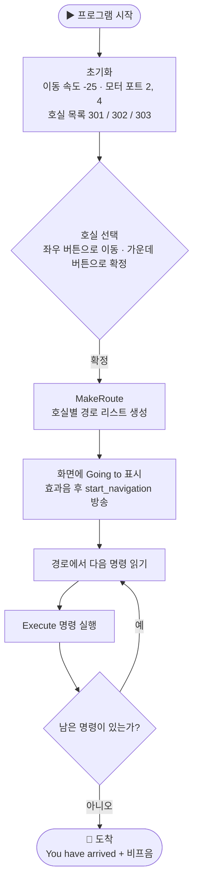
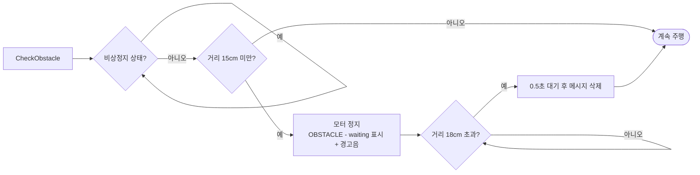
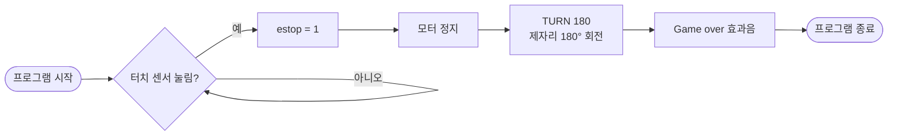

<div align="center">

# 🤖 강의실 안내 로봇

**기본 EV3 센서만으로 만든 실내 강의실 안내 로봇**

신입생과 방문객이 원하는 강의실까지 안전하게 찾아갈 수 있도록 안내합니다.


</div>

<br>

<p align="center">
  

</p>

---

## 📑 목차

- [프로젝트 소개](#-프로젝트-소개)
- [주요 기능](#-주요-기능)
- [하드웨어 구성](#-하드웨어-구성)
- [경로 지도](#-경로-지도)
- [동작 원리](#-동작-원리)
- [사용 방법](#-사용-방법)
- [설정값과 호실 추가](#-설정값과-호실-추가)
- [장점과 한계](#-장점과-한계)
- [향후 계획](#-향후-계획)
- [저장소 구조](#-저장소-구조)

---

## 📌 프로젝트 소개


대학 건물에서 처음 온 사람은 강의실을 찾기 어렵습니다. 이 프로젝트는 **LEGO EV3 로봇이 목적지까지 직접 안내**해 주는 것을 목표로 합니다.

공항이나 병원의 안내 로봇은 고가의 고성능 센서를 사용하지만, 이 로봇은 **EV3 기본 센서(초음파 · 컬러 · 터치)만으로** 같은 역할을 하도록 설계했습니다.

사용자가 브릭 버튼으로 호실을 고르면, 로봇이 바닥의 **노란 스티커**를 기준으로 저장된 경로를 따라 이동하고, 도착하면 화면과 소리로 알려 줍니다.

## ✨ 주요 기능

| 기능 | 설명 |
| --- | --- |
| 🎯 **호실 선택** | EV3 브릭의 버튼으로 목적지(301 / 302 / 303)를 선택 |
| 📚 **다중 경로 저장** | 호실마다 `FOLLOW` · `LEFT` · `RIGHT` · `DRIVE` 명령으로 이루어진 경로를 저장 |
| 🟡 **스티커 인식** | 바닥을 향한 컬러 센서가 노란 스티커를 감지하면 정지 후 다음 명령 실행 |
| 🚧 **장애물 대응** | 앞에 장애물이 있으면 정지 + 경고음, 사라지면 자동으로 재출발 |
| 🛑 **비상정지** | 터치 센서를 누르면 즉시 정지 후 180° 회전하고 프로그램 종료 |
| 🔔 **도착 안내** | 화면에 `You have arrived`와 호실 번호를 표시하고 비프음 재생 |

## 🧩 하드웨어 구성

| 부품 | 포트 | 역할 |
| --- | :---: | --- |
| EV3 브릭 | – | 제어 · 화면 · 버튼 입력 · Bluetooth |
| 대형 모터 × 2 (좌 / 우) | 출력 2 · 4 (B · D) | 무한궤도 구동 |
| 초음파 거리 센서 | 입력 1 | 전방 장애물 거리 측정 |
| 터치 센서 | 입력 2 | 비상정지 버튼 |
| 컬러 센서 (바닥 향함) | 입력 3 | 노란 스티커 감지 |

- 구동부는 **LEGO Robot Trainer** 기반이며, 바퀴 대신 **무한궤도(트랙)** 를 사용했습니다.
- 소프트웨어는 **EV3 Classroom** (블록 코딩)으로 작성했습니다.

## 📍 경로 지도

> 위 이미지는 프로그램의 경로 데이터(`MakeRoute`)를 바탕으로 그린 **개략도**입니다. 실제 거리와 배치는 다를 수 있습니다.

모든 경로는 출발점에서 **노란 스티커 ①** 까지 직진하는 것으로 시작합니다.

| 목적지 | 경로 명령 | 이동 순서 |
| :---: | --- | --- |
| **301호** | `FOLLOW` → `LEFT` → `FOLLOW` → `RIGHT` | ①까지 직진 → 좌회전 → 스티커 ②까지 직진 → 우회전 → 도착 |
| **302호** | `FOLLOW` → `DRIVE` | ①까지 직진 → 약 5초 더 직진 → 도착 |
| **303호** | `FOLLOW` → `RIGHT` → `FOLLOW` → `LEFT` | ①까지 직진 → 우회전 → 스티커 ②까지 직진 → 좌회전 → 도착 |

### 명령어 정리

| 명령 | 호출 블록 | 동작 |
| :---: | --- | --- |
| `FOLLOW` | `FollowLineUntilMarker` | 컬러 센서가 노란색을 볼 때까지 직진한 뒤 정지, 짧은 비프음 |
| `LEFT` | `Turn 110` | 0.3바퀴 전진해 스티커를 벗어난 뒤 제자리 좌회전 |
| `RIGHT` | `Turn -100` | 0.3바퀴 전진해 스티커를 벗어난 뒤 제자리 우회전 |
| `DRIVE` | `repeat 50` | 0.1초 간격으로 50회, 약 5초간 직진 후 정지 |
| `CROSS` | `CrossMarker` | 노란색이 아닐 때까지 직진 (스티커 통과용, 현재 경로에서는 미사용) |

## 🧠 동작 원리


### 1. 전체 흐름



### 2. 장애물 검사 (`CheckObstacle`)

주행하는 모든 반복문 안에서 매번 호출됩니다.



> 정지(15cm)와 재출발(18cm) 기준을 다르게 둬서, 경계 거리에서 **멈췄다 출발했다를 반복하는 떨림**을 막았습니다.

### 3. 비상정지

메인 프로그램과 **동시에** 실행되는 스크립트입니다.



### 4. 블록 구조

<details>
<summary><b>사용자 정의 블록 · 변수 · 리스트 보기</b></summary>

<br>

| 사용자 정의 블록 | 역할 |
| --- | --- |
| `MakeRoute` | 선택한 호실(`target`)에 맞는 명령을 `route_current` 리스트에 채움 |
| `Execute %s` | 명령 문자열(`FOLLOW` / `LEFT` / `RIGHT` / `CROSS` / `DRIVE`)에 맞는 동작 실행 |
| `FollowLineUntilMarker` | 노란 스티커가 보일 때까지 직진 |
| `Turn %s` | 스티커를 벗어날 만큼 전진 후 제자리 회전 |
| `CrossMarker` | 스티커 위를 벗어날 때까지 직진 |
| `CheckObstacle` | 장애물 감지 시 정지 · 대기 · 재출발 |
| `MakeLineForDergee %s` | 모터 엔코더 각도 기준 직진 (현재 미사용) |

| 변수 / 리스트 | 용도 |
| --- | --- |
| `target` | 선택된 호실 번호 |
| `selected_index` | 선택 화면에서 현재 가리키는 목록 위치 |
| `step` | 경로에서 현재 실행 중인 단계 번호 |
| `estop` | 비상정지 여부 (0 = 정상, 1 = 정지) |
| `rooms` | 선택 가능한 호실 목록 |
| `route_current` | 현재 선택된 호실의 명령 리스트 |

</details>

## 🚀 사용 방법

1. **EV3 Classroom**을 설치하고 `project1410_v8.lmsp` 파일을 엽니다.
2. EV3 브릭을 **Bluetooth**로 연결합니다.
3. 하드웨어를 위 [구성표](#-하드웨어-구성)의 포트에 맞게 연결합니다.
4. 로봇을 출발점에 놓습니다. 컬러 센서는 바닥을 향해 있어야 하고, 노란 스티커 위에서 시작하면 안 됩니다.
5. 프로그램을 실행하고 브릭 화면에서 **좌우 버튼으로 호실을 고른 뒤 가운데 버튼으로 확정**합니다.
6. 로봇이 출발합니다. 위험할 때는 **터치 센서**를 눌러 멈춥니다.

## 🔧 설정값과 호실 추가

### 주요 설정값

| 항목 | 값 | 위치 |
| --- | --- | --- |
| 이동 속도 | `-25` | 프로그램 시작 블록 (`movement speed`) |
| 장애물 정지 거리 | `15 cm` 미만 | `CheckObstacle` |
| 장애물 재출발 거리 | `18 cm` 초과 | `CheckObstacle` |
| 회전 전 전진량 | `0.3` 바퀴 | `Turn %s` |
| 회전량 | `1.5` 바퀴 | `Turn %s` |
| `DRIVE` 시간 | `0.1초 × 50회` | `Execute %s` |
| 비상정지 회전 | 조향 `100`, `2.5` 바퀴 | 비상정지 스크립트 |

> 트랙 마모나 바닥 재질에 따라 회전각이 달라질 수 있습니다. 회전이 맞지 않으면 `Turn %s`의 **회전량**부터 조정하세요.

### 새 호실 추가하기

1. 프로그램 시작 블록에서 `rooms` 리스트에 호실 번호를 추가합니다. (예: `304`)
2. `MakeRoute` 블록에 `if target = 304` 분기를 만들고 명령을 순서대로 추가합니다.

```text
if target = 304
    add FOLLOW to route_current
    add RIGHT  to route_current
    add DRIVE  to route_current
```

## 📊 장점과 한계

| | 공항 · 병원 안내 로봇 | 이 프로젝트 |
| --- | --- | --- |
| 센서 | 고가의 고성능 센서 | EV3 기본 센서 (초음파 · 컬러 · 터치) |
| 경로 방식 | – | 바닥 스티커 + 저장된 경로 명령 |

**👍 장점**
- 여러 경로를 저장해 두고 선택할 수 있어, 단순한 라인 트레이서보다 활용도가 높습니다.
- 무한궤도라서 경사에서도 안정적이고 회전 오차가 작습니다.

**⚠️ 한계**
- 계단은 오를 수 없습니다.
- 궤도에 돌기가 없어서 쉽게 마모됩니다.
- 경로가 코드에 직접 들어 있어, 새 경로는 블록을 수정해야 합니다.

## 🔭 향후 계획

- [ ] 주행 미끄러짐 보정
- [ ] 도착 지점 바닥 스티커 감지
- [ ] **Python 버전**으로 재작성 (microSD로 코드 로드)
- [ ] **스마트폰 앱**으로 호실 선택 (Bluetooth 또는 인터넷)
- [ ] 스마트폰에서 경로를 그리거나 조이스틱으로 실시간 제어

## 📁 저장소 구조

```text
.
├── README.md
├── project1410_v8.lmsp      # EV3 Classroom 프로젝트 파일
└── assets/
    └── route-map.svg        # 경로 개략도
```

---

<div align="center">

**만든 사람** · 사일라우바예브아얀([@zvcwv](https://github.com/zvcwv))

</div>
